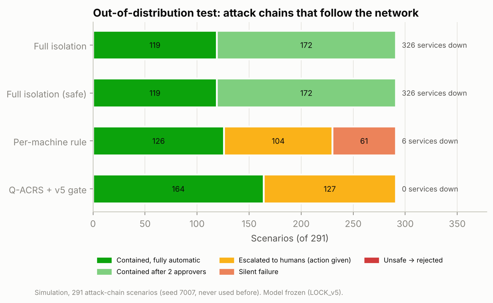

# Q-ACRS — Results v6 (out-of-distribution, latency)

> Generated by `python -m qacrs.report_v6` from `backend/qacrs/results/v6`. Criteria fixed in advance in `PREREGISTRATION_v6.md`. Model frozen (`LOCK_v5.json` checked before running). Simulation.

## E11 — Attack chains (different generator, seed 7007)

291 scenarios after dropping 109 duplicates. Mean hacked machines 2.85; two simultaneous chains in 40.5%; a chain reaches the database or domain controller in 59.1%.

| Method | Contained | …of which needs 2 approvers | Escalated | Silent | Rejected (unsafe) | Services down |
|---|---|---|---|---|---|---|
| Full isolation | 291 | 172 | 0 | 0 | 0 | 326 |
| Full isolation (safe) | 291 | 172 | 0 | 0 | 0 | 326 |
| Per-machine rule | 126 | 0 | 104 | 61 | 0 | 6 |
| Q-ACRS + v5 gate | 164 | 0 | 127 | 0 | 0 | 0 |

| Pre-registered hypothesis | Result | Verdict |
|---|---|---|
| H2-v5-OOD (silent failures, Wilson upper ≤ 2%) | v3 gate 4 → v5 gate 0/291, CI 0.0%–1.3% | supported |
| H1-v3 (≥80% containment AND fewer services down) | ratio 0.5636; services 0 vs 326 | **not supported** |
| H3 (fewer services down, Wilcoxon one-sided) | p = 1.6e-33 | supported |
| H4 (containment, exact McNemar) | Q-ACRS-only 0 vs safe-full-only 127, p = 1.2e-38 | safe full isolation contains more |
| Escalation rate (human workload) | 43.6% (Wilson 38.1%–49.4%) | reported, no threshold |

**Why H1 fails here:** attack chains often end on the database or domain controller. Q-ACRS never isolates a critical server by itself; it escalates (G1: 123, G3: 4 scenarios). Safe full isolation proposes isolating that server, which the pre-registered rule counts as "contained, pending two-person approval" — even though it also needs humans and takes the services down.

### Exploratory (NOT pre-registered): who needs a human?

Counting only outcomes that need **no human at all**:

| Method | Fully automatic containment | Needs a human (2 approvers or escalation) |
|---|---|---|
| Q-ACRS + v5 gate | 164 (56.4%, Wilson 50.6%–61.9%) | 127 |
| Full isolation (safe) | 119 (40.9%, Wilson 35.4%–46.6%) | 172 |

Paired: Q-ACRS-only 48 vs safe-full-only 3 (exact McNemar p = 2.0e-11). This view was chosen after seeing the results, so it is a hypothesis for the next pre-registration, not a finding.

## E12 — Decision latency (scenario → policy ready)

Machine: x86_64, 2 CPUs (this cloud container). Pipeline: reduced QUBO + exact solve + safety layer + v5 gate + executor plan (dry run). Median of 3 repetitions per scenario.

| Set | Scenarios | Median (ms) | 95th percentile (ms) | Max (ms) |
|---|---|---|---|---|
| development | 40 | 0.08 | 0.27 | 0.36 |
| heldout_9001 | 482 | 0.09 | 0.32 | 1.44 |
| heldout_9002 | 456 | 0.10 | 0.53 | 15.64 |
| ood_7007 | 291 | 0.13 | 0.27 | 1.29 |
| scaling_52_machines | 15 | 0.15 | 61.52 | 62.77 |

Target (p95 < 1000 ms and max < 7000 ms): **met**. The quantum solver is not in this pipeline (exact classical solve); QAOA on hardware would add queue and run time.
